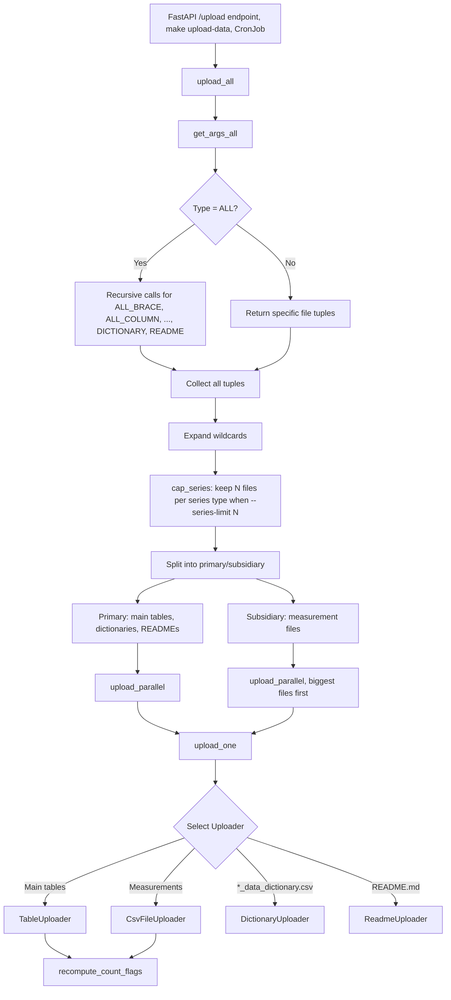

# Flow of uploader.py

`upload_all` is what `make upload-data`, the `/upload` endpoint and the
in-cluster CronJob run. It ends by recomputing the `*_count` flags of every
main table, so specimens without curves show "no test data".

# The four uploaders

```mermaid
flowchart TD
    subgraph TableUploader
        T1[Read CSV with headers] --> T2{Headers match DB columns?}
        T2 -->|No| T3[Raise Error]
        T2 -->|Yes| T4[Create DB Session]
        T4 --> T5[For each row: convert types, session.merge]
        T5 --> T6[Delete rows whose id is no longer in the CSV]
        T6 --> T7[Commit]
    end

    subgraph CsvFileUploader
        C1[Parse filename for the parent id] --> C2[Read CSV, validate required columns]
        C2 --> C3[Build plain dict rows, no ORM objects]
        C3 --> C4[Delete the parent's old rows]
        C4 --> C5[One COPY FROM STDIN for the whole file]
        C5 --> C6{Foreign key error?}
        C6 -->|Yes| C7[Roll back, log, skip the file]
        C6 -->|No| C8[Commit]
    end

    subgraph DictionaryUploader
        D1[Read *_data_dictionary.csv] --> D2[Replace the rows of that database in dictionary_column, group included]
    end

    subgraph ReadmeUploader
        R1[Read the folder README.md] --> R2[Replace the row of that database in database_readme]
    end
```

The perf notes behind `COPY` and the biggest-first scheduling are in
`docs/modernization-followups.md`.
