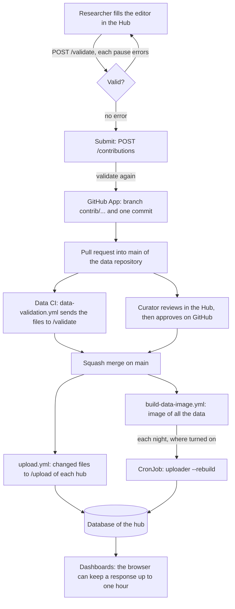

# How data gets into the Hub

This page shows the full path of an experiment, from the submit button in the
Hub to a row on the public dashboards. Read it first. Then go to the page for
your role: [submit with the Hub](submit-with-the-hub.md),
[submit with a pull request](../data/contributing.md),
[review and verify](review-and-verify.md) or
[run the data pipeline](../run-the-pipeline.md).

The data does not live in the Hub. It lives in CSV files in the public
repository [RESSLab-Team/resslab-hub-data][data-repo] (the data repository).
Each change to the data is a pull request on that repository. The Hub reads
the `main` branch of the data repository and copies it into its database.

## The path in one picture

## The steps

1. Submit. A researcher with the `contributor` role fills the editor at
   `/contribute`. At each pause, the editor sends the data to `POST /validate`.
   Errors block the submit. Warnings do not block it.
2. Validation. `POST /contributions` runs the same validator again on the
   server. It also refuses an id that already exists in the data repository.
3. Branch and pull request. The GitHub App of the Hub writes one commit on a
   new branch `contrib/<type>/<first id>-<hex>`. Then it opens a pull request
   into `main`. Who submitted is written in the commit message, as trailers.
4. Data CI. On each pull request, the workflow `data-validation.yml` of the
   data repository sends the changed files to `/validate` of the production
   hub.
5. Review. A curator opens the submission in the Hub at `/curation`. The Hub
   only shows it. The curator approves and merges on GitHub.
6. Squash merge on `main`. The data repository accepts only a squash merge, so
   each pull request becomes one commit on `main`.
7. Upload. The workflow `upload.yml` sends the CSV files that the merge added
   or changed to `POST /api/upload` of each hub. The data is online some
   minutes after the merge.
8. Nightly rebuild. A Kubernetes CronJob empties the data tables and uploads
   the full `main` again. It removes the files that were deleted and fixes an
   upload that failed. Today it runs each night on dev only.
9. Cache. The backend keeps each data response for up to one hour
   (`CACHE_MAX_AGE`, 3600 seconds). An upload expires the copy of the server
   at once. A browser can still show its own copy until the hour ends.

New rows are `unverified` when they go online. A curator marks them as
verified later, with a second, small pull request. [Review and verify](review-and-verify.md)
explains this second step.

## Where to go next

| You are | Read |
| --- | --- |
| A researcher with data to share | [Submit with the Hub](submit-with-the-hub.md), or [submit with a pull request](../data/contributing.md) |
| A researcher who prepares the files | The page of the database in [Databases](../data/index.md) |
| A member of the lab who reviews submissions | [Review and verify](review-and-verify.md) |
| A maintainer of the Hub or of the data repository | [Run the data pipeline](../run-the-pipeline.md) |
| A developer who changes the code | [Contribution internals](../contributing-data.md) and [Curation internals](../curation.md) |

[data-repo]: https://github.com/RESSLab-Team/resslab-hub-data
